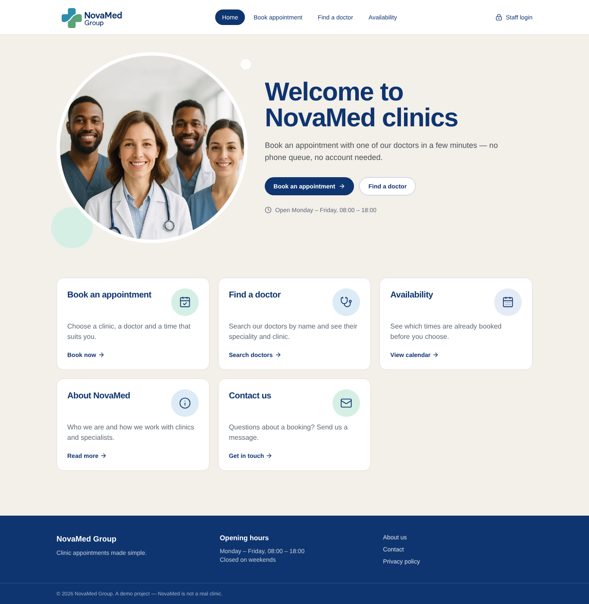
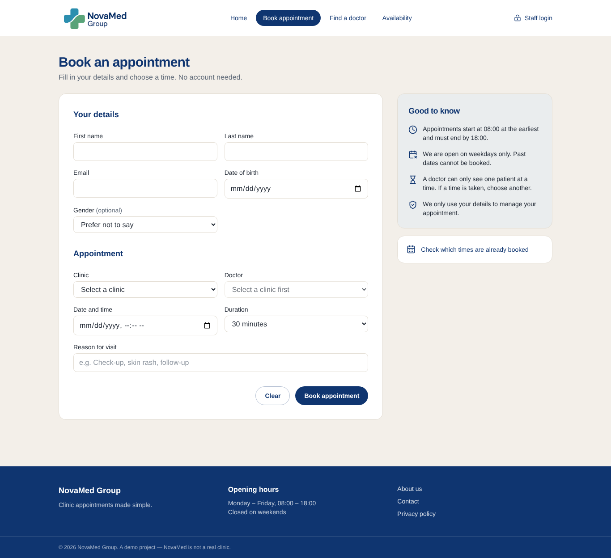
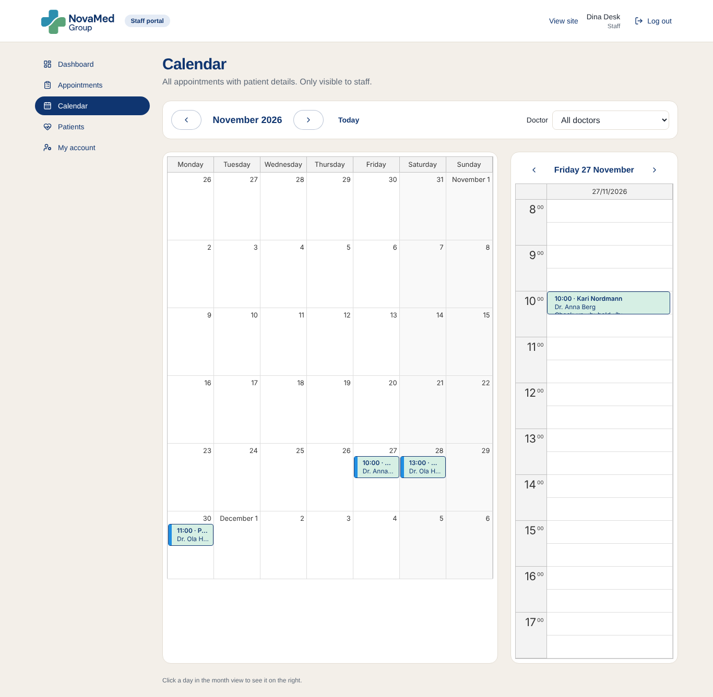

# NOVAMED Clinic Appointment Booking System


A full-stack appointment booking system for a fictional clinic group, **NOVAMED**. Patients book online without an account; front-desk staff and admins manage everything in a role-based staff portal.

**Stack:** ASP.NET Core 8 · Entity Framework Core · MySQL · Next.js 16 · React 19 · TypeScript · Tailwind CSS · xUnit · GitHub Actions · Docker



## Highlights

- **Booking rules in one place.** Working hours, weekdays only, no double booking of a doctor or a patient. Enforced the same way on create, update and public booking, and covered by tests.
- **Role-based access in three layers.** The Next.js proxy, the page itself and the API each check the user's role. A fallback policy makes every new endpoint private unless it is explicitly marked public.
- **The token never reaches client-side JavaScript.** The JWT is kept in an httpOnly cookie, and the browser never calls the API directly: Server Components and Server Actions do (a small "backend for frontend").
- **Patient data stays private.** The public calendar shows busy times only, and patient details are visible to logged-in staff only.
- **Tested and automated.** 106 unit and integration tests run on every push, together with frontend linting, type checking and a production build.
- **One-command setup.** `docker compose up` starts MySQL, the API and the frontend, applies the migrations and creates the first admin.

## Screenshots

| Booking | Staff portal |
|---|---|
|  |  |

## Features

### Public site

- **Home** (`/`): landing page with quick links
- **Book an appointment** (`/book`): no account needed; doctors are filtered by the chosen clinic, and the booking rules are shown next to the form
- **Find a doctor** (`/doctors`): all doctors, with search by first and last name
- **Availability** (`/calendar`): month and day view of booked times, filterable by doctor, with no patient data
- **About us, Contact, Privacy policy**

### Staff portal (`/staff`)

- **Dashboard**: today's and upcoming appointments
- **Appointments, Calendar, Patients**: Staff and Admin
- **Doctors, Clinics, Specialities, Staff users**: Admin only
- **My account**: change your own password
- A patient, doctor or clinic that still has appointments cannot be deleted

## Roles

| Role | Can do |
|---|---|
| **Public** (no login) | Book an appointment, search doctors, see clinics, doctors, specialities and busy times |
| **Staff** (front desk) | Everything public, plus manage appointments and patients |
| **Admin** | Everything Staff can, plus manage clinics, doctors, specialities and staff accounts |

- **No public registration.** The first admin is created on startup from the `SeedAdmin` settings (only when there are no users yet). All other accounts are created by an admin.
- Passwords are hashed with ASP.NET Core's `PasswordHasher` (PBKDF2). Emails are stored lower-case and must be unique.
- Login is limited to 5 attempts per minute per IP address, and gives the same error for an unknown email and a wrong password.

## Booking Rules

All rules live in `backend/Services/AppointmentValidator.cs`:

- Weekdays only
- The whole appointment must fit inside working hours: it starts at **08:00** or later and ends by **18:00**
- No bookings in the past, and the duration must be greater than zero
- A **doctor** cannot have two overlapping appointments
- A **patient** cannot have two overlapping appointments
- The doctor, clinic and patient must exist
- When booking with patient details, an existing patient is matched by name and email. A new patient is only created if the appointment itself is valid.

The current time comes from .NET's `TimeProvider`, so the rules are tested against a fixed date.

## Getting Started

### Option A: Docker (easiest)

Runs MySQL, the API and the frontend in containers. No local MySQL, .NET or Node.js needed.

```bash
cp .env.example .env      # set the passwords, JWT_KEY and the first admin
docker compose up -d --build
```

- Frontend: http://localhost:3000
- Swagger: http://localhost:5196/swagger
- On the first start the API applies the EF Core migrations and creates the admin from `SEED_ADMIN_*`
- MySQL data is kept in the `db-data` volume (`docker compose down -v` deletes it)
- Behind HTTPS, set `SESSION_COOKIE_SECURE=true`

### Option B: Local development

Requires the .NET 8 SDK, Node.js 22 and a local MySQL server.

**1. Backend configuration.** Create `backend/appsettings.json` (git-ignored, see `appsettings.json.sample.txt`):

```json
{
  "ConnectionStrings": {
    "DefaultConnection": "Server=localhost;Database=medicalclinics;user=root;password=yourpassword"
  },
  "Jwt": {
    "Key": "a-random-secret-of-at-least-32-characters",
    "Issuer": "ClinicBooking",
    "Audience": "ClinicBooking",
    "ExpiryMinutes": 60
  },
  "SeedAdmin": {
    "Email": "admin@novamed.no",
    "Password": "at-least-8-characters",
    "FullName": "Administrator"
  },
  "AllowedHosts": "*"
}
```

The API refuses to start without a `Jwt:Key` of at least 32 characters.

**2. Database.**

```bash
cd backend
dotnet ef database update
```

**3. Frontend configuration.** Create `frontend/.env.local` (see `env.local.example`):

```
API_URL="http://localhost:5196/api"
```

**4. Run both** from the root folder (uses `concurrently`):

```bash
npm install
npm run dev
```

The frontend runs on http://localhost:3000 and Swagger on http://localhost:5196/swagger.

## Tests & CI

Backend tests live in `backend.Tests/` (xUnit) and need no database server.

- **Unit tests:** booking rules, appointment and user endpoints, login, the admin seeder, and an authorization matrix that fails when a new endpoint is added without deciding who may call it
- **Integration tests:** the real API pipeline through `WebApplicationFactory` with an in-memory database. They cover 401 without a token, 403 for Staff on admin endpoints, real JWT login, rejected forged tokens, public booking and the login rate limit.

```bash
dotnet test backend.Tests
# or, from the root folder
npm test
```

**GitHub Actions** (`.github/workflows/ci.yml`) runs on every push and pull request:

- **Backend:** restore, build, test (results uploaded as an artifact)
- **Frontend:** `npm ci`, lint, type check, production build

## API Overview

| Resource | Endpoints | Access |
|---|---|---|
| **Appointments** | `GET/POST /api/appointments`, `GET/PUT/DELETE /api/appointments/{id}` | Staff, Admin |
| **Public booking** | `POST /api/appointments/with-patient` | Public |
| **Busy slots** | `GET /api/appointments/busy?from=&to=&doctorId=` | Public |
| **Patients** | `GET/POST /api/patients`, `GET/PUT/DELETE /api/patients/{id}` | Staff, Admin |
| **Doctors, Clinics, Specialities** | `GET` lists and details | Public |
| | `POST`, `PUT`, `DELETE` | Admin |
| **Doctor search** | `POST /api/search/doctors` | Public |
| **Auth** | `POST /api/auth/login`, `GET /api/auth/me`, `PUT /api/auth/password` | Login / logged in |
| **Users** | `GET/POST /api/users`, `PUT /api/users/{id}/password`, `DELETE /api/users/{id}` | Admin |

List endpoints always return `200 OK` (an empty list when there is nothing). In Swagger, log in with `POST /api/auth/login`, then paste the token into the **Authorize** button.

## Project Structure

```
ClinicAppointmentSystem/
├── docker-compose.yml      # MySQL + API + frontend
├── .github/workflows/      # CI
├── backend/
│   ├── Controllers/        # Appointments, Patients, Doctors, Clinics, Specialities, Search, Auth, Users
│   ├── DTOs/               # request/response shapes (entities are never returned directly)
│   ├── Models/
│   ├── Auth/               # JWT options and claim names
│   ├── Services/           # AppointmentValidator, token service, admin seeder
│   └── Migrations/
├── backend.Tests/
│   ├── Unit/
│   └── Integration/
└── frontend/
    ├── app/
    │   ├── (site)/         # public pages
    │   └── staff/          # staff portal
    ├── components/         # ui/, site/, staff/, forms/, calendar/
    ├── lib/
    │   ├── api.ts          # server-side API client (adds the JWT)
    │   ├── session.ts      # reads the session cookie
    │   └── actions/        # Server Actions: auth, public, staff
    └── proxy.ts            # redirects logged-out users, and Staff away from admin-only pages
```

## Notes

- Patient data (name, email, date of birth, reason for visit) is only visible to logged-in staff.
- NOVAMED, its texts and images are placeholders and have no relation to any real clinic.
- The calendar uses [DayPilot Lite](https://code.daypilot.org).
